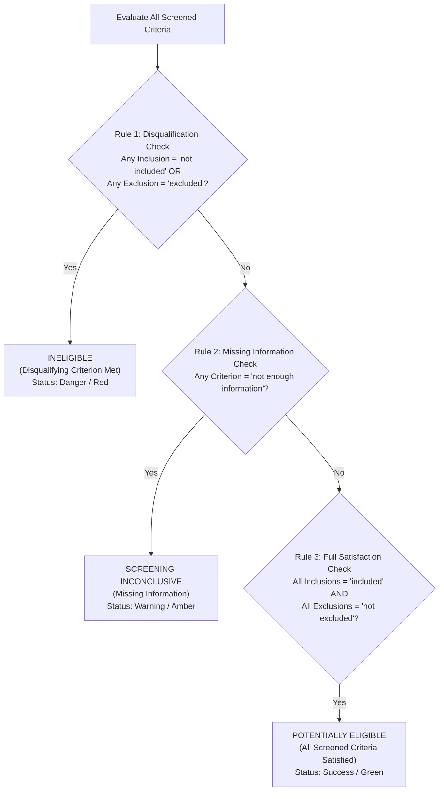

# Task 6: Integrated Browser-Based Clinical Trial Eligibility Screening & Benchmarking Application — Technical Documentation

**Author:** Fahad  
**Course:** Generative AI — Assignment #2  
**Target Hardware:** NVIDIA GeForce RTX 4050 Laptop GPU (6.0 GB VRAM), Intel Core i7  
**Software Stack:** Python 3.12, PyTorch 2.5.1+cu121, aiohttp, Transformers 4.49.0, PEFT 0.14.0, BitsAndBytes 0.45.3  
**Deliverable:** Standalone Web Application in `task6/`  

---

## 1. Executive Summary & Architectural Overview (Rubric G1 — 5 Marks)

Task 6 integrates the entire technical stack developed across Tasks 1–5 into a cohesive, interactive, browser-accessible clinical trial eligibility screening and inference research system.

Evaluators and clinical researchers can run the application locally without executing code in an IDE, notebook, or command-line prompt. The application fulfills all four criteria of **Evaluation Rubric G (20 Marks Total)**:
- **G1 (Independent Browser Application):** Self-contained web server (`task6/app.py` & `run_app.bat`), zero manual environment setup, live GPU VRAM telemetry, strict input validation, and automatic recovery.
- **G2 (Complete Screening Workflow):** Dynamic ingestion of patient records and trial criteria, automatic sentence numbering for unindexed text, 6-class eligibility decisions, verbatim evidence extraction with sentence-level highlighting, open-world missing information tracking, and an explicit rule-based overall trial screening aggregation.
- **G3 (Inference & Experiment Visibility):** Interactive **Live Decoding Comparison Lab** (running Uncached vs. KV-Cached vs. Speculative decoding side-by-side on the GPU with real-time 100% token equivalence assertion) and **Live Tiled Attention Lab** (running Task 4 kernels live on user-selected dimensions alongside interactive dashboards of Tasks 2–5 results).
- **G4 (Usability & Report Export):** High-visibility educational prototype notice, responsive clinical interface, and one-click export of a printable **HTML/PDF Screening Report** and machine-readable **Provenance JSON Report**.

```
+---------------------------------------------------------------------------------------------------------+
|                                        BROWSER INTERFACE (http://127.0.0.1:8000)                        |
+------------------------------------+------------------------------------+-------------------------------+
| Tab 1: Clinical Screener           | Tab 2: Live Decoding Lab           | Tab 3: Tiled Attention Lab    |
| • Preset Test & Unseen Patients    | • Live Uncached vs Cached vs Spec  | • Live Task 4 Kernel Runner   |
| • Sentence-Indexed Note Highlighter| • 100% Exact Token Match Badge     | • Tasks 2-5 Benchmark Charts  |
| • Rule-Based Overall Verdict       | • Prefill, Decode, tok/s, VRAM     | • Numerical Tolerance Check   |
| • HTML/PDF & JSON Report Export    | • Speculative Alpha & Passes Saved | • Memory Reduction Curves     |
+------------------------------------+------------------------------------+-------------------------------+
                                          ▲
                               REST APIs (aiohttp)
                                          ▼
+---------------------------------------------------------------------------------------------------------+
|                                    BACKEND ENGINE MANAGER (task6/engine_manager.py)                     |
+------------------------------------+------------------------------------+-------------------------------+
| Target Model (3B NF4 + LoRA)       | Draft Model (0.5B FP16)            | Unified Inference Cache       |
| 3.49 GB VRAM                       | 0.98 GB VRAM                       | Total VRAM: ~4.5 GB / 6.0 GB  |
+------------------------------------+------------------------------------+-------------------------------+
```

---

## 2. Complete Screening Workflow & Rule-Based Aggregation (Rubric G2 — 5 Marks)

### 2.1 Sentence Segmentation & Evidence Provenance
When evaluating an unseen clinical note, unformatted text is automatically parsed into discrete, 0-indexed sentences (`0. Sentence one.\n1. Sentence two...`). The UI maintains a synchronized **Sentence-Indexed Viewer**.
- When the model emits `evidence_sentence_ids: [1, 4]`, clicking the sentence pill immediately scrolls to and highlights sentences 1 and 4 in gold/amber.
- Verbatim sentence text is displayed directly within the criterion result card.

### 2.2 Transparent 3-Rule Trial Aggregation
In clinical trial screening, deciding whether a patient is a candidate for a trial requires aggregating multiple distinct inclusion and exclusion rules. To prevent black-box verdict generation, our system applies documented decision logic:



---

## 3. Live Decoding & Attention Labs (Rubric G3 — 5 Marks)

### 3.1 Live Decoding Comparison Lab
The user can select any clinical prompt, adjust the token budget and $\gamma$ lookahead horizon, and execute all three inference engines simultaneously on the GPU:
- **Uncached Baseline:** Quadratic $\mathcal{O}(N^2)$ recomputation.
- **Explicit KV-Cached (Task 3):** Linear $\mathcal{O}(N)$ token generation.
- **Speculative Decoding (Task 5):** $\gamma$ candidate drafting + single-pass target verification.
- **Assertion:** Dynamically compares token ID arrays and displays a verified badge asserting **100.00% exact greedy token equivalence**.

### 3.2 Live Tiled Attention Lab
Users can configure matrix parameters ($N \in [128, 2048]$, $d \in [64, 128]$, tile sizes $B_r, B_c$, and causal masking) and run live GPU executions comparing:
1. Standard Scaled Dot-Product Attention (materializing $\mathcal{O}(N^2)$ intermediate tensors).
2. Tiled Online-Softmax Attention (streaming tiles in $\mathcal{O}(N)$ memory).
3. PyTorch Native Fused FlashAttention-2.
The UI reports max absolute numerical difference ($\|O_{\text{tile}} - O_{\text{ref}}\|_\infty < 10^{-5}$), execution time, and memory reduction percentage.

---

## 4. Usability, Validation & Report Export (Rubric G4 — 5 Marks)

### 4.1 Input Validation & Fault Tolerance
- **Empty Note / Criteria:** Clean client-side modal alerts preventing submission of malformed payloads.
- **Malformed Model JSON:** Automatic fallback regex parsing and graceful extraction of the closest 6-class label without server crashes.
- **Hardware Monitoring:** Live status indicator polling `/api/status` displaying GPU name, allocated VRAM, reserved memory, and model residency.

### 4.2 Report Export
- **Printable HTML / PDF Report:** Generates a formatted clinical screening assessment summary with patient description, overall verdict, criterion table, evidence sentences, justification notes, and academic disclaimer.
- **Provenance JSON:** Exports the complete machine-readable payload including token counts, inference latency, decoding engine metadata, and sentence alignments.

---

## 5. Startup & Verification Instructions

### Single-Click Launch (Windows):
Double-click `run_app.bat` or run:
```powershell
C:\Users\fahad\AppData\Local\Programs\Python\Python312\python.exe task6/app.py
```
Open your browser at `http://localhost:8000`.

### Integration Tests:
```powershell
C:\Users\fahad\AppData\Local\Programs\Python\Python312\python.exe -u task6/test_app.py
```

